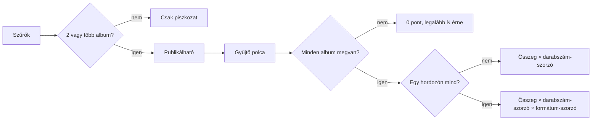

# Web: collection-ök pontozása

**Követelmények:** [REQ-SCORE-*](../../felhasznaloi/gyujtemeny-pontozas.md)

A vázlatok kézzel készültek; a megvalósítás után valódi felvételre cseréljük őket.

## Collection kártya

- **Belépés:** `/collections` lista, a profil és a kezdőlap collection-sorai.

```
┌────────────────────────────────┐
│ [mozaik]            ◔ jelvény  │
│ Bay Area Thrash '83–'90        │
│ 8 album · 6 megvan             │
│ ▓▓▓▓▓▓▓▓▓▓▓░░░░  75%           │
│ legalább 133 pont   ×1,50 db   │
└────────────────────────────────┘
```

| Állapot                                | Pont-sor                                                        |
| -------------------------------------- | --------------------------------------------------------------- |
| nincs meg belőle semmi / kijelentkezve | „Alapérték: 60 pont” és a darabszám-szorzó                      |
| folyamatban                            | „legalább N pont” (meglévők valódi ponttal, hiányzók 5 ponttal) |
| teljes, vegyes                         | „141 pont” kiemelve                                             |
| teljes, egységes                       | „222 pont” kiemelve és formátum-jelzés: „Csupa vinyl ×1,5”      |
| szünetel (2 album alatt)               | a kártya nem jelenik meg a listákban                            |

## Így áll össze a pontszám

- **Belépés:** a collection lapja (`/collections/:slug`). A fejléc pontszáma alatt a szorzók chipjei, az
  oldalsávban a levezetés panelje, az albumrácson albumonként a hordozó és a ritkaság.

```
Fejléc                                   Oldalsáv: „Így áll össze a pontszám”
┌───────────────────────────┐            ┌──────────────────────────────────┐
│            141 PONT       │            │ Albumok pontjai            94,25 │
│            megszerezve    │            │ Darabszám-szorzó (8 album) ×1,50 │
│ [×1,50 · 8 album] [vegyes]│            │ Formátum-szorzó (vegyes)   ×1,00 │
└───────────────────────────┘            │ ──────────────────────────────── │
                                         │ Összesen                 141 pont│
Albumrács, egy album                     │                                  │
┌──────────┐                             │ ▸ Csupa vinyl sorozat            │
│ [borító] │                             │   Még 2 album kell vinylen:      │
│ Vinyl    │                             │   Bonded by Blood, Eternal…      │
│ ● Ritka  │                             │   legalább 222 pont (+81)        │
│ 16 pont  │                             │                                  │
└──────────┘                             │ Albumonként ▾                    │
                                         │  Kill 'Em All  Vinyl · Ritka  16 │
                                         │  …                               │
                                         │ Hogyan számolunk?                │
                                         └──────────────────────────────────┘
```

| Állapot                     | Mit lát                                                                                        |
| --------------------------- | ---------------------------------------------------------------------------------------------- |
| kijelentkezve               | alapérték, darabszám-szorzó, „Jelentkezz be, hogy a polcod szerint számoljunk”                 |
| nincs meg belőle semmi      | alapérték és a képlet rövid magyarázata; levezetés nincs                                       |
| folyamatban                 | „legalább N pont, ha teljes”; a hiányzó albumok sora „hiányzik · 5” szürkén                    |
| teljes, vegyes              | levezetés; tipp az egységes sorozathoz, ha valamelyik hordozón megvan az albumok legalább fele |
| teljes, egységes            | levezetés a formátum-szorzóval; a tipp helyén „Csupa vinyl sorozat ×1,5” jelzés                |
| több példány egy albumból   | az albumsor a számító példányt mutatja, alatta: „2 példányod van, ez számít”                   |
| ritkaság még nincs számolva | a szint „Gyakori”, mellette „még nem számoltuk ki” megjegyzés                                  |

- **Albumonként:** alapból csukva, 12 albumnál nagyobb collection-nél lapozva. A sor a számító példány
  lapjára visz.
- **Hogyan számolunk?:** felugró ablak a három táblával (hordozó, ritkaság, szorzók) és egy példával.
- **Tipp:** egyszerre legfeljebb egy hordozóra, arra, amelyik a legtöbb pontot adná.

## Ritkaság a kiadás és a példány lapján

- **Belépés:** kiadás lapja (`/release/:id`), példány lapja, a polc példány-kártyája.

```
┌──────────────────────────────────────────┐
│ ● Ritka  ×1,6                            │
│ 214 Discogs-gyűjtőnek van meg            │
└──────────────────────────────────────────┘
```

| Forrás                | A jelzés alatti sor                                              |
| --------------------- | ---------------------------------------------------------------- |
| Discogs               | „N Discogs-gyűjtőnek van meg”                                    |
| példányszám           | „N darab készült belőle”                                         |
| katalógus-címkék      | „Limitált kiadás” / „Eredeti nyomás, 1986”                       |
| kurátori felülbírálat | „Kurátor állította be” és az indoklás                            |
| általános példány     | „Gyakori — add meg a pontos kiadást, hogy a ritkasága számítson” |

Admin a kiadás szerkesztőjében látja a példányszám mezőt. A felülbírálat a kiadás lapján van, a tények alatt:
szint, indoklás, „Felülbírálás mentése”, „Felülbírálás törlése” és „Újraszámolás most”.

## Szerkesztő: a szűrők és az érték

- **Belépés:** admin → Collection-ök → új vagy meglévő collection.

```
┌ Szűrők ────────────────────┐ ┌ Előnézet ────────────────────────┐
│ Évek        1983 – 1990    │ │ 8 album illik a szűrőkre         │
│ Stílus      Thrash Metal   │ │ Alapérték: 60 pont               │
│ Ország      US             │ │ Darabszám-szorzó: ×1,50          │
│ + szűrő                    │ │ [borítók…]                       │
└────────────────────────────┘ └──────────────────────────────────┘
                                   [ Piszkozat mentése ] [ Publikálás ]
```

| Állapot                         | Mit lát                                                                                                     |
| ------------------------------- | ----------------------------------------------------------------------------------------------------------- |
| nincs szűrő                     | „Adj meg legalább egy szűrőt” — a Publikálás tiltva                                                         |
| 0 vagy 1 album                  | „A szűrőkre 1 album illik. Collection 2 albumtól publikálható.” — a Publikálás tiltva, a piszkozat menthető |
| 2 vagy több album               | albumszám, alapérték, darabszám-szorzó, a borítók                                                           |
| publikált, de 2 album alá esett | a listában „Szünetel” jelzés, a szerkesztőben figyelmeztetés                                                |
| mentés nem sikerül              | a szerver hibaüzenete a gombok fölött                                                                       |

A szerkesztőben nincs pontérték mező, és nincs mód albumot egyenként hozzáadni vagy kivenni.

## Folyamat


